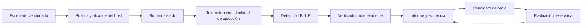

# Arquitectura PURPLE propuesta

2026-10-26. Diseño pendiente de implementación. Actualmente hay análisis pasivo,
scanners, gates, un scheduler y benchmarks; no se ha demostrado un circuito PURPLE
que mida de extremo a extremo emulación, telemetría y detección.

## Contratos y límites

Componentes originales: registro de escenarios, correlación de ejecución/evento,
verificador de cobertura y expediente. Reutilizar `lab.Authorizer`, `swarm`,
`evidence` y `evolve` mediante adaptadores. No extender permisos al cargar un
escenario. El runner no accede a producción y solo puede escribir en su entorno.
El generador de reglas no modifica el verificador ni el corpus reservado.

Un escenario declara ID/versión, ATT&CK versión y técnicas, autorización,
precondiciones, imagen por digest, acciones permitidas, telemetría esperada,
duración máxima, resultado observable y limpieza. El manifiesto de ejecución
incluye tenant/tarea/run, versión de reglas, hashes de herramientas, reloj y
errores. Etiquetar técnica no demuestra que se haya emulado.

## Flujo y estados de cobertura

1. Validar alcance, identidad y sensores; guardar decisión auditada.
2. Ejecutar una simulación local aprobada y registrar inicio/fin con un ID propio.
3. Recopilar eventos y confirmar que pertenecen a esa ejecución y organización.
4. Aplicar detecciones y comprobar evidencia de la técnica mediante un verificador.
5. Medir retrasos, faltantes y falsas alarmas frente a controles benignos.
6. Proponer reglas en un catálogo candidato y evaluarlas con positivos/negativos.
7. Promover solo después de no regresión, licencia y prueba reservada.
8. Publicar informe que conserve fallos, omisiones y limpieza del entorno.

| Estado | Requisito | Interpretación |
|---|---|---|
| No evaluada | Sin ejecución válida | No cuenta como detectada ni como fallo de detección. |
| Fallo de escenario | No ocurrió el comportamiento esperado | Reparar fixture; no puntuar al detector. |
| Telemetría insuficiente | Emulación comprobada, datos esperados ausentes | Brecha de sensor/pipeline; no esconderla en promedios. |
| Emulada, no detectada | Emulación y eventos comprobados, sin alerta válida en ventana | Brecha demostrada para ese escenario. |
| Detectada | Alerta enlazada a eventos y técnica realmente ejecutada | Cobertura demostrada limitada a versión/escenario/sensor. |
| Detección incorrecta | Alertó por otro motivo o caso benigno | Falso positivo o atribución incorrecta. |

Usar como denominador de recall únicamente ejecuciones positivas válidas con
observabilidad suficiente, informando por separado los escenarios sin telemetría.
Publicar también el total autorizado, intentado y válido. No presentar un porcentaje
general de ATT&CK usando etiquetas de reglas como prueba.

## Tiempo y evaluación independiente

Guardar `action_started_at`, `event_observed_at`, `event_received_at` y
`alert_created_at`. Medir latencia de ingesta y de alerta por separado, indicando
sincronización y errores de reloj. La ventana expirada y los intervalos negativos
son condiciones explícitas. Un evento reinyectado no prueba detección en vivo.

El primer escenario debe ser un evento sintético benigno/positivo y una regla
original local, sin ejecutar comandos de ataque. Después, un comportamiento
controlado en una VM propia. Atomic Red Team y Caldera son referencias; su
catálogo entero no queda autorizado por integrar su formato.

Aceptación: ejecución reproducible, evidencia íntegra, ID único, aislamiento de
tenant, negativos, detección ausente diferenciada de fallo de escenario y limpieza
comprobada. Reversión: retirar escenario/regla nueva y conservar sus evidencias;
sin modificar controles de autorización.

Fuentes: [ATT&CK datos y herramientas](https://attack.mitre.org/resources/attack-data-and-tools/),
[Atomic Red Team](https://github.com/redcanaryco/atomic-red-team),
[Apache Caldera](https://github.com/apache/caldera).
Decisión: construir el verificador propio antes de incorporar más emulaciones.
